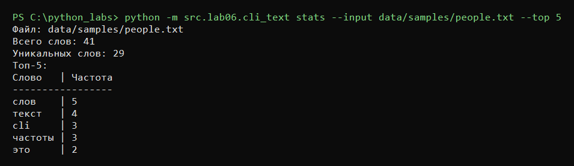
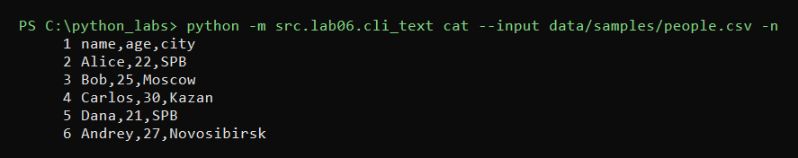
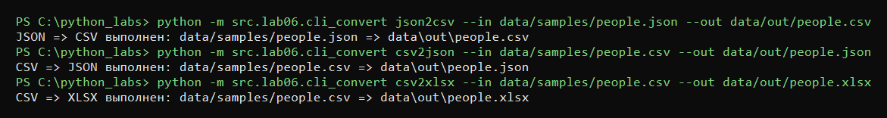
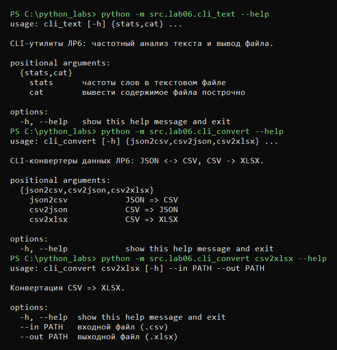
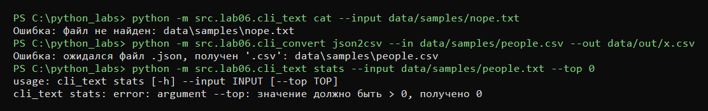

# ЛР_06 — CLI-утилиты на argparse

Обёртки над ранее написанными функциями:
- `cli_text.py` — подкоманды `stats` и `cat` (частотный анализ через функции из [lab03](/src/lab03/text_stats.py));
- `cli_convert.py` — подкоманды `json2csv`, `csv2json`, `csv2xlsx` (конвертеры из [lab05](/src/lab05)).

## Установка

Для `stats` и `cat` достаточно стандартной библиотеки (`argparse`, `pathlib`, `sys`).
Для подкоманды `csv2xlsx` используется `openpyxl` из `requirements.txt` (как в ЛР5).

```bash
pip install -r requirements.txt
```

## Запуск

Все команды запускаются из корня проекта `python_labs`.
Для корректного вывода кириллицы в консоли: `chcp 65001`.

```bash
# частоты слов (топ-5 по умолчанию)
python -m src.lab06.cli_text stats --input data/samples/people.txt --top 5

# вывод файла построчно с нумерацией
python -m src.lab06.cli_text cat --input data/samples/people.csv -n

# конвертеры
python -m src.lab06.cli_convert json2csv --in data/samples/people.json --out data/out/people.csv
python -m src.lab06.cli_convert csv2json --in data/samples/people.csv --out data/out/people.json
python -m src.lab06.cli_convert csv2xlsx --in data/samples/people.csv --out data/out/people.xlsx
```

Справка по любой команде:

```bash
python -m src.lab06.cli_text --help
python -m src.lab06.cli_text stats --help
python -m src.lab06.cli_convert --help
python -m src.lab06.cli_convert csv2xlsx --help
```

## Подкоманды и параметры

### cli_text.py

| Подкоманда | Параметр | Обязательный | Описание |
|---|---|---|---|
| `stats` | `--input PATH` | да | путь к текстовому файлу для анализа |
| `stats` | `--top N` | нет (по умолчанию `5`) | сколько самых частых слов показать, `N > 0` |
| `cat` | `--input PATH` | да | путь к файлу, который надо вывести |
| `cat` | `-n`, `--number` | нет | нумеровать строки |

### cli_convert.py

| Подкоманда | Параметр | Обязательный | Описание |
|---|---|---|---|
| `json2csv` | `--in PATH` | да | входной `.json` |
| `json2csv` | `--out PATH` | да | выходной `.csv` |
| `csv2json` | `--in PATH` / `--out PATH` | да | входной `.csv` / выходной `.json` |
| `csv2xlsx` | `--in PATH` / `--out PATH` | да | входной `.csv` / выходной `.xlsx` |

`--in` разбирается как `dest="input"`, потому что `in` — зарезервированное слово Python.
Если каталог для `--out` не существует, он создаётся автоматически (`Path.mkdir(parents=True, exist_ok=True)`).

## Задание А. `cli_text.py`

Подкоманды создаются через `parser.add_subparsers(dest='command')`, у каждой подкоманды свой набор аргументов.
В `set_defaults(func=...)` кладётся обработчик, а `main()` вызывает `args.func(args)` — так не нужна длинная цепочка `if args.command == ...`.
Ошибки файлов (`FileNotFoundError`) и данных (`ValueError`) перехватываются в `main()`, печатаются в `stderr` человекочитаемо, процесс завершается с кодом `1`.
Неверный аргумент командной строки (например, `--top abc`) отлавливает сам argparse: он печатает `usage` и `error`, код возврата `2`.

```python
import argparse
import sys
from pathlib import Path

from src.lib.text import tokenize, count_freq, top_n

# Ширина номера строки для команды cat -n
LINE_NUMBER_WIDTH = 6


def positive_int(value: str) -> int:
    """Тип аргумента argparse: целое число больше нуля."""
    try:
        number = int(value)
    except ValueError:
        raise argparse.ArgumentTypeError(f"'{value}' не является целым числом")
    if number <= 0:
        raise argparse.ArgumentTypeError(f"значение должно быть > 0, получено {number}")
    return number


def read_text_file(path_str: str, *, allow_any_extension: bool = True) -> str:
    """Читает текстовый файл в UTF-8, проверяя его наличие и расширение."""
    path = Path(path_str)
    if not path.exists():
        raise FileNotFoundError(f"файл не найден: {path}")
    if not path.is_file():
        raise ValueError(f"это не файл: {path}")
    if not allow_any_extension and path.suffix.lower() != '.txt':
        raise ValueError(f"ожидался файл .txt, получен '{path.suffix}'")
    try:
        return path.read_text(encoding='utf-8')
    except UnicodeDecodeError:
        raise ValueError(f"файл не является текстом в кодировке UTF-8: {path}")


def print_freq_table(top: list[tuple[str, int]]) -> None:
    """Печатает частоты слов в виде таблицы (как в lab03)."""
    max_word_len = max((len(word) for word, _ in top), default=0)
    max_word_len = max(max_word_len, len('Слово'))
    print(f"{'Слово':<{max_word_len}} | Частота")
    print('-' * (max_word_len + 3 + len('Частота')))  # 3 — символы ' | '
    for word, count in top:
        print(f"{word:<{max_word_len}} | {count}")


def cmd_stats(args: argparse.Namespace) -> int:
    """Подкоманда stats: топ частотных слов в тексте."""
    text = read_text_file(args.input)

    tokens = tokenize(text)
    freq = count_freq(tokens)
    top = top_n(freq, n=args.top)

    if not tokens:
        print(f"В файле '{args.input}' не найдено ни одного слова.")
        return 0

    print(f"Файл: {args.input}")
    print(f"Всего слов: {len(tokens)}")
    print(f"Уникальных слов: {len(freq)}")
    print(f"Топ-{args.top}:")
    print_freq_table(top)
    return 0


def cmd_cat(args: argparse.Namespace) -> int:
    """Подкоманда cat: построчный вывод файла с нумерацией при -n."""
    text = read_text_file(args.input)

    for number, line in enumerate(text.splitlines(), start=1):
        if args.number:
            print(f"{number:>{LINE_NUMBER_WIDTH}}\t{line}")
        else:
            print(line)
    return 0


def build_parser() -> argparse.ArgumentParser:
    """Собирает парсер с подкомандами stats и cat."""
    parser = argparse.ArgumentParser(
        prog='cli_text',
        description='CLI-утилиты ЛР6: частотный анализ текста и вывод файла.',
    )
    subparsers = parser.add_subparsers(dest='command', metavar='{stats,cat}')

    stats_parser = subparsers.add_parser(
        'stats',
        help='частоты слов в текстовом файле',
        description='Считает частоты слов (функции lab03) и выводит топ-N.',
    )
    stats_parser.add_argument(
        '--input', required=True,
        help='путь к текстовому файлу (.txt) для анализа',
    )
    stats_parser.add_argument(
        '--top', type=positive_int, default=5,
        help='сколько самых частых слов показать (по умолчанию 5)',
    )
    stats_parser.set_defaults(func=cmd_stats)

    cat_parser = subparsers.add_parser(
        'cat',
        help='вывести содержимое файла построчно',
        description='Выводит содержимое файла построчно (аналог cat/grep-lite).',
    )
    cat_parser.add_argument(
        '--input', required=True,
        help='путь к файлу для вывода',
    )
    cat_parser.add_argument(
        '-n', '--number', action='store_true',
        help='нумеровать строки',
    )
    cat_parser.set_defaults(func=cmd_cat)

    return parser


def main(argv: list[str] | None = None) -> int:
    """Точка входа CLI. Возвращает код возврата процесса."""
    parser = build_parser()
    args = parser.parse_args(argv)

    if not getattr(args, 'func', None):
        parser.print_help()
        print('\nОшибка: не указана подкоманда (stats или cat).', file=sys.stderr)
        return 1

    try:
        return args.func(args)
    except FileNotFoundError as error:
        print(f'Ошибка: {error}', file=sys.stderr)
        return 1
    except ValueError as error:
        print(f'Ошибка: {error}', file=sys.stderr)
        return 1


if __name__ == '__main__':
    sys.exit(main())
```

### Образец: `stats`

Файл [people.txt](/data/samples/people.txt) — небольшой демонстрационный текст.
Команда:

```bash
chcp 65001
python -m src.lab06.cli_text stats --input data/samples/people.txt --top 5
```

Вывод:

```text
Файл: data/samples/people.txt
Всего слов: 41
Уникальных слов: 29
Топ-5:
Слово   | Частота
-----------------
слов    | 5
текст   | 4
cli     | 3
частоты | 3
это     | 2
```

### Образец: `cat -n`

```bash
python -m src.lab06.cli_text cat --input data/samples/people.csv -n
```

```text
     1  name,age,city
     2  Alice,22,SPB
     3  Bob,25,Moscow
     4  Carlos,30,Kazan
     5  Dana,21,SPB
     6  Andrey,27,Novosibirsk
```

Без флага `-n` те же строки печатаются без номеров. Внутри `cat` используется `enumerate(text.splitlines(), start=1)`, поэтому нумерация идёт с единицы и не зависит от наличия `\n` в конце файла.

### Справка `stats --help`

```text
usage: cli_text stats [-h] --input INPUT [--top TOP]

Считает частоты слов (функции lab03) и выводит топ-N.

options:
  -h, --help     show this help message and exit
  --input INPUT  путь к текстовому файлу (.txt) для анализа
  --top TOP      сколько самых частых слов показать (по умолчанию 5)
```

## Задание B. `cli_convert.py`

Здесь только оболочка: вся конвертация выполняется функциями `json_to_csv`, `csv_to_json` (lab05/json_csv.py) и `csv_to_xlsx` (lab05/csv_xlsx.py).
CLI проверяет существование входного файла и расширения до вызова конвертера, а также сам создаёт каталог для результата.
Повторяющиеся подкоманды описываются в цикле по кортежу `commands`, чтобы не копировать одинаковые `add_argument`.

```python
import argparse
import sys
from pathlib import Path

from src.lab05.json_csv import json_to_csv, csv_to_json
from src.lab05.csv_xlsx import csv_to_xlsx


def check_file(path_str: str, expected_suffix: str) -> Path:
    """Проверяет существование входного файла и его расширение."""
    path = Path(path_str)
    if not path.exists():
        raise FileNotFoundError(f"файл не найден: {path}")
    if not path.is_file():
        raise ValueError(f"это не файл: {path}")
    if path.suffix.lower() != expected_suffix:
        raise ValueError(f"ожидался файл {expected_suffix}, получен '{path.suffix}': {path}")
    return path


def prepare_output(path_str: str, expected_suffix: str) -> str:
    """Проверяет расширение выходного файла и создаёт каталог при необходимости."""
    path = Path(path_str)
    if path.suffix.lower() != expected_suffix:
        raise ValueError(f"выходной файл должен быть {expected_suffix}, получен '{path.suffix}'")
    path.parent.mkdir(parents=True, exist_ok=True)
    return str(path)


def cmd_json2csv(args: argparse.Namespace) -> int:
    """JSON-список словарей => CSV."""
    check_file(args.input, '.json')
    output = prepare_output(args.output, '.csv')
    json_to_csv(args.input, output)
    print(f"JSON => CSV выполнен: {args.input} => {output}")
    return 0


def cmd_csv2json(args: argparse.Namespace) -> int:
    """CSV => JSON-список словарей."""
    check_file(args.input, '.csv')
    output = prepare_output(args.output, '.json')
    csv_to_json(args.input, output)
    print(f"CSV => JSON выполнен: {args.input} => {output}")
    return 0


def cmd_csv2xlsx(args: argparse.Namespace) -> int:
    """CSV => XLSX (нужна библиотека openpyxl)."""
    check_file(args.input, '.csv')
    output = prepare_output(args.output, '.xlsx')
    csv_to_xlsx(args.input, output)
    print(f"CSV => XLSX выполнен: {args.input} => {output}")
    return 0


def build_parser() -> argparse.ArgumentParser:
    """Собирает парсер с подкомандами-конвертерами."""
    parser = argparse.ArgumentParser(
        prog='cli_convert',
        description='CLI-конвертеры данных ЛР6: JSON <-> CSV, CSV -> XLSX.',
    )
    subparsers = parser.add_subparsers(dest='command', metavar='{json2csv,csv2json,csv2xlsx}')

    commands = (
        ('json2csv', 'JSON => CSV', cmd_json2csv, '.json', '.csv'),
        ('csv2json', 'CSV => JSON', cmd_csv2json, '.csv', '.json'),
        ('csv2xlsx', 'CSV => XLSX', cmd_csv2xlsx, '.csv', '.xlsx'),
    )

    for name, description, handler, in_suffix, out_suffix in commands:
        subparser = subparsers.add_parser(
            name,
            help=description,
            description=f'Конвертация {description}.',
        )
        subparser.add_argument(
            '--in', dest='input', required=True,
            metavar='PATH',
            help=f'входной файл ({in_suffix})',
        )
        subparser.add_argument(
            '--out', dest='output', required=True,
            metavar='PATH',
            help=f'выходной файл ({out_suffix})',
        )
        subparser.set_defaults(func=handler)

    return parser


def main(argv: list[str] | None = None) -> int:
    """Точка входа CLI. Возвращает код возврата процесса."""
    parser = build_parser()
    args = parser.parse_args(argv)

    if not getattr(args, 'func', None):
        parser.print_help()
        print('\nОшибка: не указана подкоманда (json2csv, csv2json или csv2xlsx).', file=sys.stderr)
        return 1

    try:
        return args.func(args)
    except FileNotFoundError as error:
        print(f'Ошибка: {error}', file=sys.stderr)
        return 1
    except ValueError as error:
        print(f'Ошибка: {error}', file=sys.stderr)
        return 1


if __name__ == '__main__':
    sys.exit(main())
```

### Образцы конвертации (все три подкоманды)

```bash
python -m src.lab06.cli_convert json2csv --in data/samples/people.json --out data/out/people.csv
python -m src.lab06.cli_convert csv2json --in data/samples/people.csv --out data/out/people.json
python -m src.lab06.cli_convert csv2xlsx --in data/samples/people.csv --out data/out/people.xlsx
```

Вывод:

```text
JSON => CSV выполнен: data/samples/people.json => data\out\people.csv
CSV => JSON выполнен: data/samples/people.csv => data\out\people.json
CSV => XLSX выполнен: data/samples/people.csv => data\out\people.xlsx
```

Результаты в `data/out/`:
- [people.csv](/data/out/people.csv) — 5 строк данных + заголовок;
- [people.json](/data/out/people.json) — 5 объектов, кириллица/UTF-8 сохраняется;
- [people.xlsx](/data/out/people.xlsx) — лист `Sheet1`, 6 строк × 3 колонки, ширина колонок подстроена.

Проверка xlsx через `openpyxl`:

```text
sheet: Sheet1 rows: 6 cols: 3
('name', 'age', 'city')
('Alice', '22', 'SPB')
...
widths: {'A': 8.0, 'B': 8.0, 'C': 13.0}
```

### Справка `cli_convert --help`

```text
usage: cli_convert [-h] {json2csv,csv2json,csv2xlsx} ...

CLI-конвертеры данных ЛР6: JSON <-> CSV, CSV -> XLSX.

positional arguments:
  {json2csv,csv2json,csv2xlsx}
    json2csv            JSON => CSV
    csv2json            CSV => JSON
    csv2xlsx            CSV => XLSX

options:
  -h, --help            show this help message and exit
```

## Обработка ошибок

| Ситуация | Поведение | Код возврата |
|---|---|---|
| Входного файла нет | `FileNotFoundError` -> `Ошибка: файл не найден: ...` в stderr | `1` |
| Неверное расширение входа | `ValueError` -> `Ошибка: ожидался файл .json, получен '.csv': ...` | `1` |
| Неверное расширение выхода | `ValueError` -> `Ошибка: выходной файл должен быть .csv, ...` | `1` |
| `--top abc` | argparse: `cli_text stats: error: argument --top: 'abc' не является целым числом` | `2` |
| `--top 0` | argparse: `... значение должно быть > 0, получено 0` | `2` |
| Подкоманда не указана | печатается `--help` + сообщение в stderr | `1` |
| Нет обязательного `--input`/`--in` | argparse: `error: the following arguments are required: --input` | `2` |

Примеры реальных сообщений:

```text
> python -m src.lab06.cli_text cat --input data/samples/nope.txt
Ошибка: файл не найден: data\samples\nope.txt

> python -m src.lab06.cli_convert json2csv --in data/samples/people.csv --out data/out/x.csv
Ошибка: ожидался файл .json, получен '.csv': data\samples\people.csv

> python -m src.lab06.cli_text stats --input data/samples/people.txt --top 0
usage: cli_text stats [-h] --input INPUT [--top TOP]
cli_text stats: error: argument --top: значение должно быть > 0, получено 0
```

## Скриншоты

Скриншоты терминала лежат в `images/lab06/`:

- `images/lab06/stats.png` — `stats --input data/samples/people.txt --top 5`;
- `images/lab06/cat_n.png` — `cat --input data/samples/people.csv -n`;
- `images/lab06/convert.png` — три подкоманды конвертации;
- `images/lab06/help.png` — `cli_text --help` и `cli_convert csv2xlsx --help`;
- `images/lab06/errors.png` — примеры ошибок (нет файла, неверное расширение, `--top 0`).








